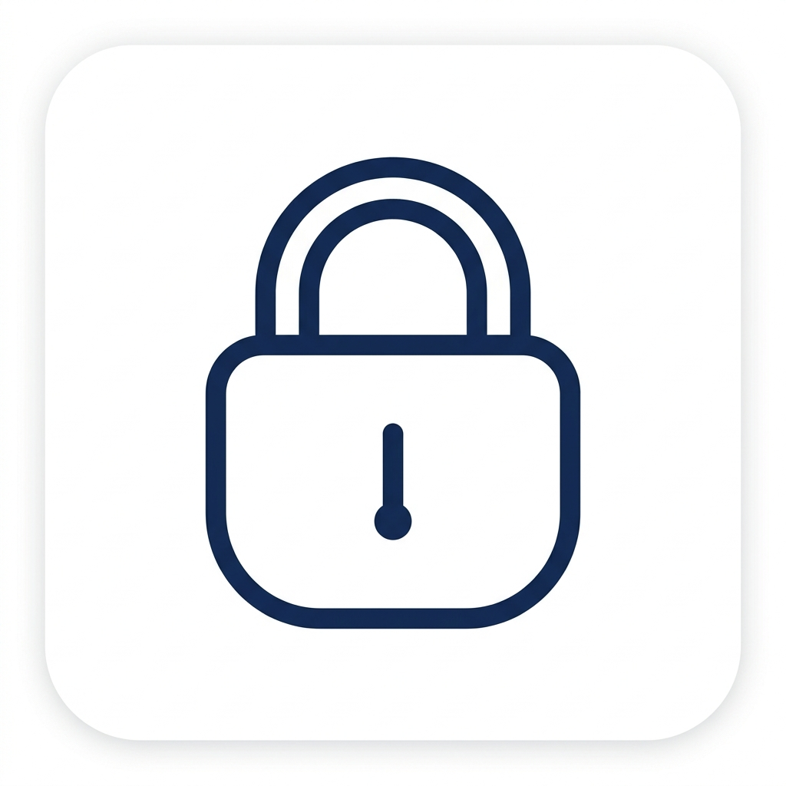

#  Pocket Locker

Pocket Locker es una aplicación móvil diseñada para abrir y cerrar puertas peatonales y portones automáticos de garaje desde tu teléfono móvil mediante conexión Bluetooth con una placa ESP32. 

El sistema utiliza autenticación criptográfica HMAC-SHA256 con protección contra ataques de repetición (anti-replay), garantizando que solo los dispositivos autorizados puedan activar los relés de apertura.

---

## Requisitos Previos

### Hardware necesario
- 1 Placa de desarrollo ESP32 (ESP32 Dev Module, NodeMCU-32S o similar).
- 1 Módulo de relés de 2 canales (5V o 3.3V).
- Cables de conexión (Jumpers hembra-hembra / macho-hembra).
- 1 Cable micro-USB / USB-C para programar el ESP32.
- 1 Teléfono móvil con Android 8.0+ o iOS 13+.

### Software necesario en tu ordenador
- Git: [git-scm.com](https://git-scm.com/)
- Node.js (versión 18 o superior): [nodejs.org](https://nodejs.org/)
- Visual Studio Code: [code.visualstudio.com](https://code.visualstudio.com/)
- Extensión **PlatformIO IDE** para VS Code.

---

## Esquema de Conexión del Hardware (ESP32 y Relés)

Conecta los pines del ESP32 a la placa de relés según esta tabla:

| Pin ESP32 | Pin Módulo Relé | Función |
| :--- | :--- | :--- |
| **GPIO 26** | IN1 | Control de apertura del Portón / Garaje |
| **GPIO 27** | IN2 | Control de apertura de la Puerta Peatonal |
| **VIN / 5V** | VCC | Alimentación eléctrica del módulo de relés |
| **GND** | GND | Masa común |

---

## Guía Paso a Paso de Instalación y Puesta en Marcha

### Paso 1: Clonar el repositorio
Abre una terminal en tu ordenador y ejecuta:

```bash
git clone https://github.com/yoakeyinn/pocket-locker.git
cd pocket-locker
```

---

### Paso 2: Programar el Firmware en el ESP32

1. Abre **Visual Studio Code**.
2. Asegúrate de tener instalada la extensión **PlatformIO IDE** (búscala en la pestaña de extensiones con `Ctrl+Shift+X`).
3. Ve a **Archivo > Abrir carpeta...** y selecciona la subcarpeta `esp32` de este repositorio (`pocket-locker/esp32`).
4. Conecta la placa ESP32 al puerto USB de tu ordenador con el cable.
5. Abre la terminal de PlatformIO o presiona el botón de la flecha hacia la derecha (**Upload**) en la barra inferior azul de VS Code. También puedes ejecutar por comando:
   ```bash
   pio run -t upload
   ```
6. Cuando la terminal muestre `[SUCCESS]`, el ESP32 ya estará emitiendo señal Bluetooth con el nombre **sblas20** y el PIN por defecto **7492**.

---

### Paso 3: Instalar las Dependencias de la App Móvil

1. En la terminal de tu ordenador, sitúate en la raíz del proyecto (`pocket-locker`):
   ```bash
   cd ..
   ```
2. Instala todas las librerías necesarias ejecutando:
   ```bash
   npm install
   ```

---

### Paso 4: Ejecutar la App en tu Teléfono

Tienes dos formas de probar la aplicación:

#### Opción A: Modo Simulación (Rápido, con Expo Go)
Ideal para probar el diseño y funcionamiento visual sin cables ni microcontrolador físico.

1. Instala la app **Expo Go** en tu móvil desde Google Play Store o Apple App Store.
2. Inicia el servidor de desarrollo en tu ordenador:
   ```bash
   npx expo start
   ```
3. Escanea el código QR que aparece en la terminal con la cámara de tu móvil (iOS) o desde la app Expo Go (Android).
4. Dentro de la app, pulsa el icono de depuración (herramienta en la cabecera) para activar el **Modo Simulación**.

#### Opción B: Ejecución Nativa con Bluetooth Real (Recomendado)
Para conectarte físicamente al ESP32 por Bluetooth necesitas generar la compilación nativa:

1. Conecta tu teléfono Android o iPhone a tu ordenador por cable USB (asegúrate de tener activada la Depuración por USB en Android).
2. Genera los archivos nativos de la app:
   ```bash
   npx expo prebuild
   ```
3. Compila e instala la app en tu teléfono:
   - Para Android:
     ```bash
     npx expo run:android
     ```
   - Para iOS (requiere Mac con Xcode):
     ```bash
     npx expo run:ios
     ```

---

### Paso 5: Vincular y Abrir Puertas

1. Enciende el Bluetooth de tu teléfono móvil.
2. Abre la aplicación **Pocket Locker**.
3. En la pantalla principal, pulsa **Buscar dispositivos**.
4. Selecciona el dispositivo **sblas20** de la lista.
5. Introduce el PIN de seguridad por defecto: `7492`.
6. En el panel de control, pulsa **Abrir Puerta** o **Abrir Garaje**. El ESP32 activará el relé correspondiente durante 1 segundo.

---

## Seguridad y Personalización

- **Cambiar el PIN:** Puedes modificar el PIN desde la pestaña **Ajustes** de la aplicación móvil. El nuevo PIN se guardará cifrado en el enclave seguro de tu teléfono y se sincronizará con la memoria interna del ESP32.
- **Periodo de enfriamiento:** El microcontrolador incluye una protección automática de 2 segundos entre pulsaciones para evitar sobrecalentamiento de los motores de la puerta.
